# Tu día a día, en el panel.

Manual MoiraOrdo · Edición 4 · 28/10/2026

Fuente: `docs/manual-panel.json`. Regenerar: `python scripts/generate_admin_manual.py`. Capturas de escritorio con puntos de referencia numerados. Los datos visibles son ficticios y pertenecen a WatchEcommerceDemo.

## Índice

1. Antes de empezar · página 3
2. Entrar y moverse · página 4
3. Items y atributos · página 5
4. Blog y presentación SEO · página 6
5. Solicitudes de la web · página 7
6. Contactos y pipeline · página 8
7. Planning y empresas cliente · página 9
8. Preparar un presupuesto · páginas 10-15
9. Enviar y recibir la respuesta · páginas 16-17
10. Crear y emitir una factura · páginas 18-23
11. Cobros y rectificativas · páginas 24-27
12. Marca y avisos de vencimiento · páginas 28-30
13. Emails y resumen semanal · página 31
14. Leer la analítica · página 32
15. Equipo, cuenta y módulos · página 33
16. Privacidad de contactos · página 34
17. Chuleta para el día a día · página 35

## 01 · Antes de empezar

Lo esencial para trabajar con confianza desde el primer día.

- **Comprueba la empresa activa.** Su nombre aparece arriba del menú lateral. Todo lo que consultes o guardes corresponde a esa empresa.
- **Localiza tu tarea.** Contenido reúne Items, Atributos y Blog. Operación reúne solicitudes, CRM, Planning, documentos y analítica.
- **Trabaja con tu cuenta.** Los botones disponibles dependen del rol y de los módulos habilitados.
- **Guarda y espera la confirmación.** Si falla una petición, mantén el formulario abierto y reintenta.

**Cuatro recorridos habituales**

Atender una petición: capítulos 5 y 6.

Preparar y enviar una oferta: capítulos 8 y 9.

Crear, cobrar y corregir facturas: capítulos 10 a 12.

Revisar la semana: capítulos 13 y 14.

**Cómo leer esta guía**

Los números azules sobre cada captura identifican controles; su leyenda está debajo. Las capturas son de escritorio a 1600 × 1000. Los pasos explican cómo usar cada sección sin confundir la vista previa con un guardado o envío.

**Una guía de la versión local**

Los módulos y permisos pueden cambiar lo que ves. Que una opción exista aquí no acredita que esté desplegada en todos los entornos.

## 02 · Entrar y moverse

Acceso, empresa activa y búsqueda rápida.

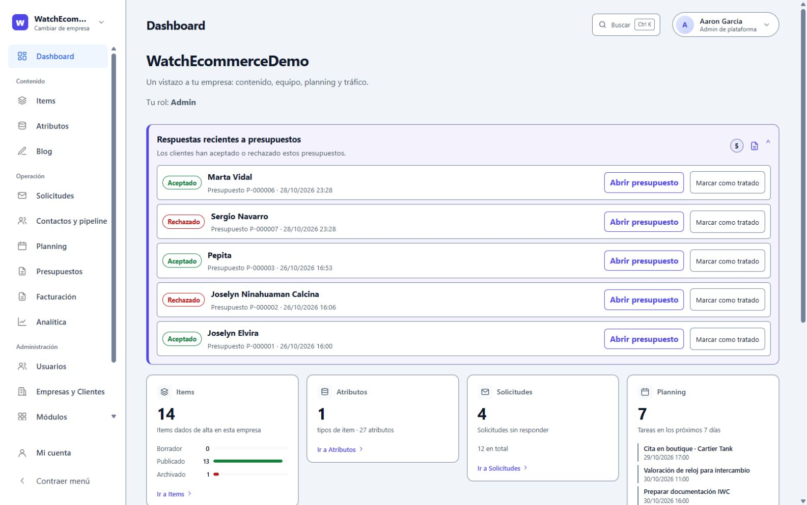

1. **Empresa activa.** Abre el selector para cambiar de compañía.
2. **Menú lateral.** Accede a las áreas de trabajo y a Mi cuenta.
3. **Buscar.** También se abre con Ctrl+K; flechas y Enter abren un resultado.
4. **Dashboard.** Resume la empresa, tu rol y la actividad disponible.

- Inicia sesión con tu cuenta. Si necesitas recuperar acceso, usa la opción de la pantalla de entrada.
- En móvil abre el menú con el botón de cabecera. En escritorio puedes contraer la barra lateral.

**Si falta una sección**

Revisa primero la empresa activa. Después pide a la persona administradora que compruebe tu rol y los módulos habilitados.

## 03 · Items y atributos

Organiza el catálogo y define los campos de sus fichas.

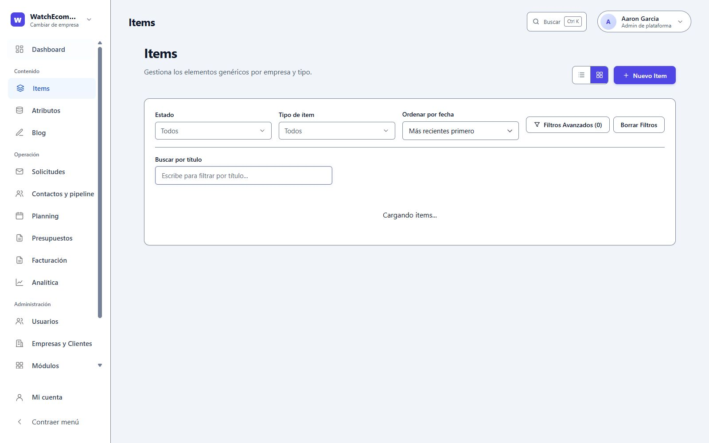

1. **Nuevo Item.** Crea una ficha y completa sus campos.
2. **Buscar por título.** Combina búsqueda con estado, tipo y orden.
3. **Filtros avanzados.** Acota por los atributos disponibles.

- Abre una ficha, revisa campos, imágenes y archivos y guarda. Comprueba la confirmación.
- En **Atributos**, elige tipo, crea o reordena campos y revisa la vista previa. Requerido y Filtrable se guardan al momento.

**Antes de borrar un atributo**

Comprueba si contiene información que debas conservar. Cambiar la estructura afecta al trabajo de todas las personas de la empresa.

## 04 · Blog y presentación SEO

Prepara contenido y revisa cómo se presenta.

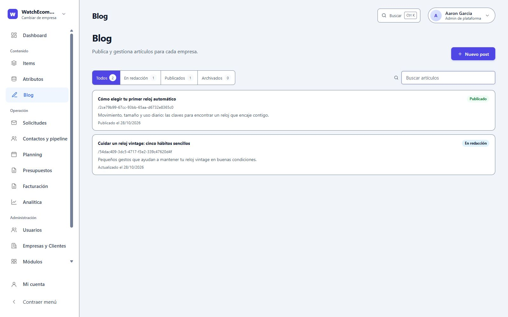

1. **Nuevo post.** Prepara título, contenido y estado editorial.
2. **Buscador.** Localiza artículos y combina los filtros de estado.

- Revisa el artículo antes de publicar. Guarda en borrador, publicado o archivado según corresponda.
- En Items, despliega SEO, revisa la propuesta de slug/título/descripción y acepta los cambios que quieras antes de guardar.

**Campos bloqueados**

Si el bloque SEO aparece en modo de solo lectura, revisa el permiso de edición. La propuesta automática no genera imágenes ni publica por sí misma.

## 05 · Solicitudes de la web

Cada formulario recibido es una conversación por atender.

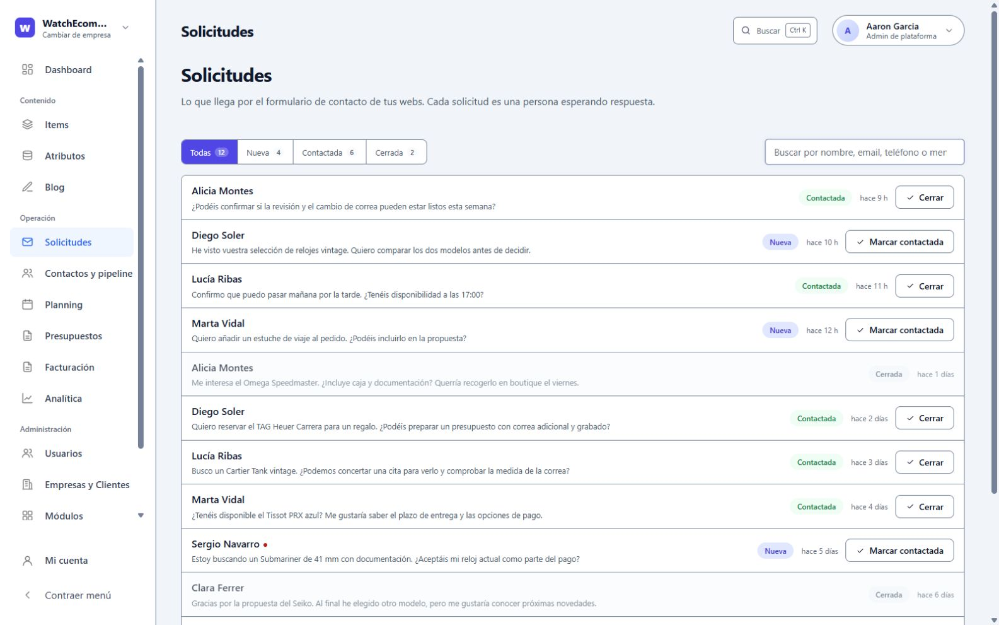

1. **Buscar solicitudes.** Localiza por nombre, email, teléfono o mensaje.
2. **Solicitud.** Abre el mensaje y revisa el estado del seguimiento.

- Cuando haya solicitudes, abre una ficha para leer contacto, mensaje y origen. Actualiza el seguimiento y guarda.
- Los enlaces HTTP/HTTPS se abren en otra pestaña. La atribución depende de lo enviado por la web de origen.

**Borrar no es cerrar una solicitud**

Si eliges eliminar, lee la confirmación: el panel no ofrece recuperación de esa eliminación. Evita incluir datos personales en notas o capturas compartidas.

## 06 · Contactos y pipeline

Convierte una solicitud en un próximo paso concreto.

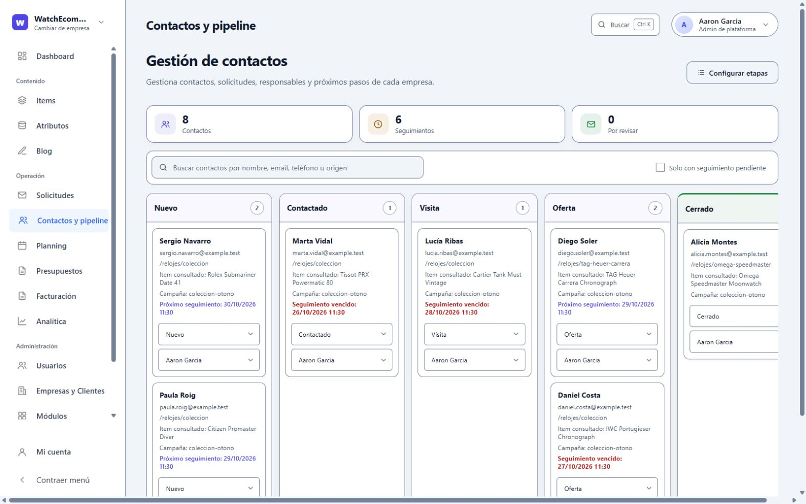

1. **Buscar contactos.** Nombre, email, teléfono u origen.
2. **Seguimientos.** Muestra solo los contactos con seguimiento pendiente.
3. **Etapas.** Administradores y editores configuran el pipeline.

- Abre la ficha para asignar responsable, etapa y próxima fecha. Registra llamadas, notas, emails o visitas.
- Enlaza documentos de esa empresa. Si email y teléfono apuntan a fichas diferentes, resuelve la revisión manual sin fusionarlas a ciegas.

**Etapas y seguimiento**

La captura muestra contactos ficticios repartidos entre las etapas del pipeline. Abre una ficha para consultar su actividad y preparar el siguiente seguimiento.

## 07 · Planning y empresas cliente

Organiza tareas, horarios y previsiones.

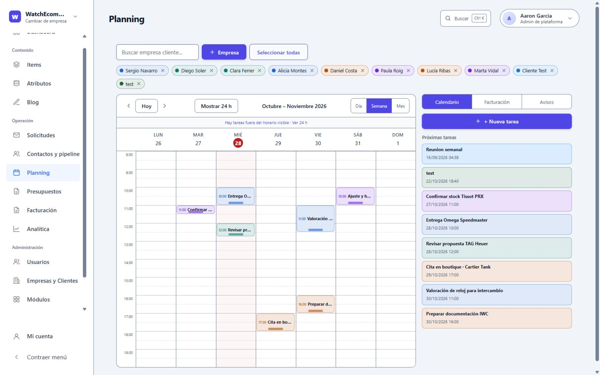

1. **Hoy.** Regresa al periodo de la fecha actual.
2. **Vista.** Alterna Día, Semana o Mes.
3. **Nueva tarea.** Define empresa cliente, fecha, horario y recurrencia.

- Selecciona empresas cliente y revisa fechas antes de guardar. Empresas y Clientes permite administrar sus fichas.
- El arrastre pide confirmación; en recurrencias afecta a la serie. Escape cancela. Deshacer depende de que no exista una edición posterior.

**Previsiones y cobros**

La vista Facturación de Planning organiza vencimientos previstos. Registra un cobro real en la ficha de la factura, en Cobros e historial.

## 08 · Preparar un presupuesto

### Presupuestos: encontrar y empezar

08 / 1 · Listado, estados y accesos rápidos.

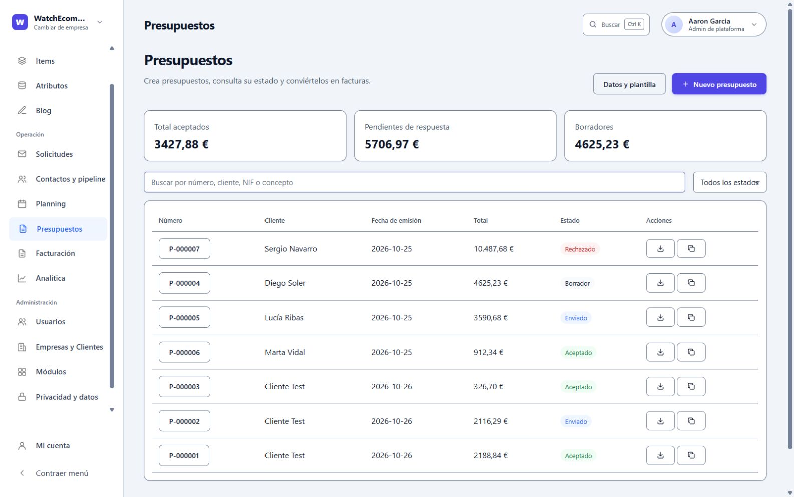

1. **Buscar.** Admite número, cliente, identificación fiscal o un concepto del documento.
2. **Estado.** Filtra Borrador, Enviado, Aceptado, Rechazado, Facturado o Cancelado.
3. **Nuevo presupuesto.** Abre el editor completo dentro del panel.
4. **Número.** Abre la ficha. Las acciones de su fila descargan o duplican.

- Los importes superiores agrupan aceptados, pendientes de respuesta y borradores; son el resumen del listado de presupuestos.
- Empieza en Borrador. Enviado indica que has preparado la propuesta para compartirla; la entrega del email se comprueba por separado.

### Cliente y datos del presupuesto

08 / 2 · Seleccionar el destinatario y preparar el documento.

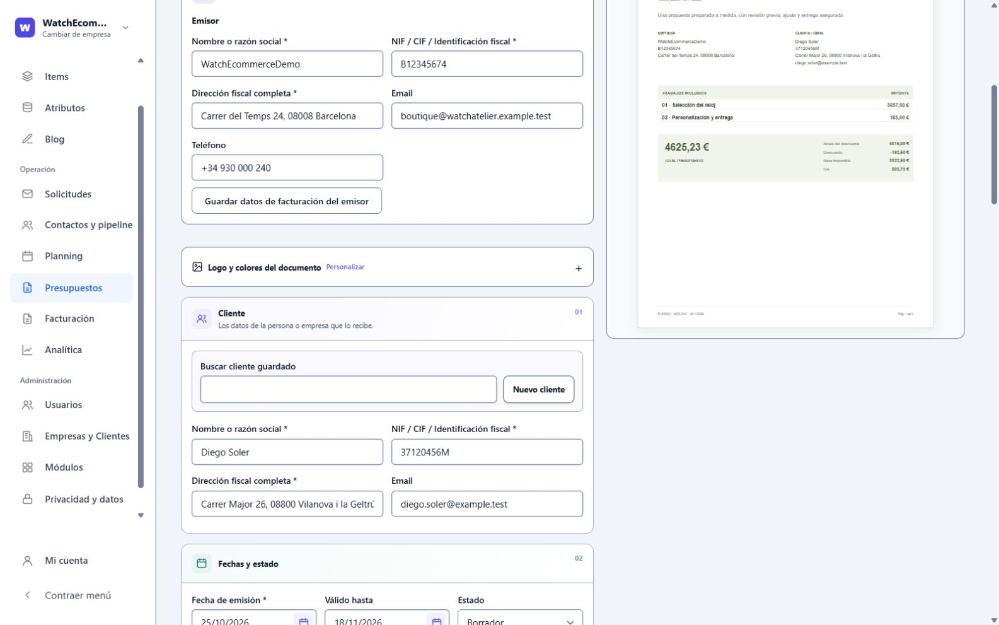

1. **Cliente guardado.** Busca y selecciona una ficha fiscal de esta empresa.
2. **Nuevo cliente.** Abre el alta sin abandonar el presupuesto.
3. **Identificación fiscal.** Revisa el NIF o CIF del destinatario.
4. **Email del cliente.** Comprueba la dirección que se utilizará si envías el enlace.

- Completa razón social, NIF e identificación y dirección fiscal. El email será necesario si quieres enviar el enlace desde el panel.
- Comprueba emisor y fechas: emisión, validez y estado. El presupuesto conserva una copia de los datos usados, aunque la ficha cambie después.

**Si falla el guardado**

Mantén el editor abierto, revisa los campos señalados y reintenta. El autoguardado de borradores no envía la oferta al cliente.

### Presentar la propuesta

08 / 3 · Contexto, condiciones y espacios de firma.

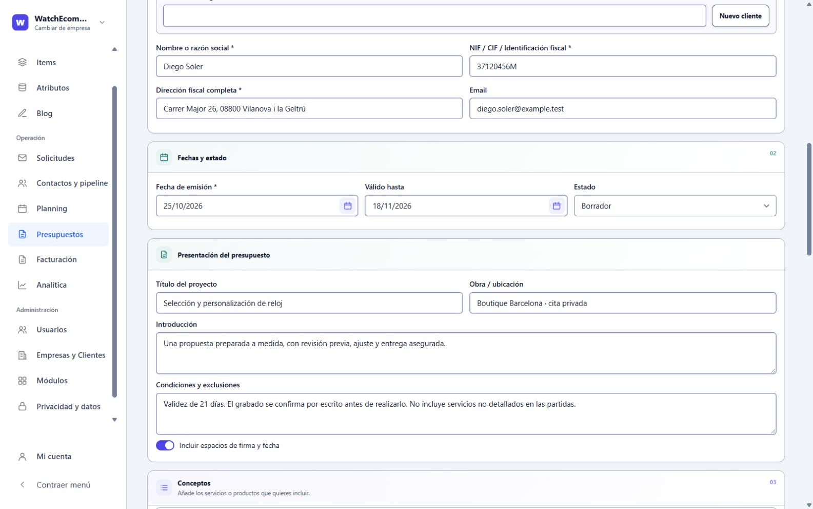

1. **Título del proyecto.** Da a la propuesta un nombre comprensible.
2. **Introducción.** Explica el alcance; utiliza ubicación y condiciones para concretarlo.
3. **Firmas.** Decide si el PDF incluirá espacios para firma y fecha.

- Separa qué incluye el trabajo de sus exclusiones. Revisa ortografía, fechas y condiciones antes de pasar a las partidas.
- Los espacios de firma impresos y la respuesta por enlace son funciones distintas. Incluir un espacio no registra una firma digital.

### Capítulos, partidas e importes

08 / 4 · Organizar el contenido y revisar cada línea.

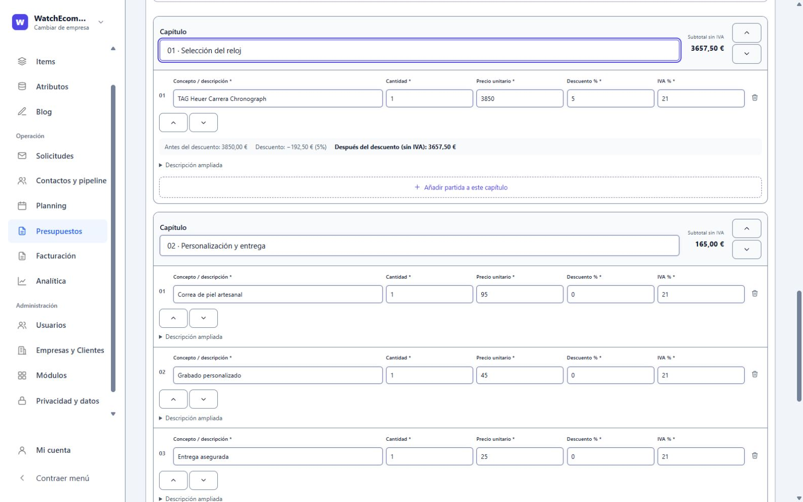

1. **Capítulo.** Pon un título y usa subir/bajar para ajustar su orden.
2. **Partida.** Revisa descripción, cantidad, precio unitario, descuento e IVA.
3. **Descripción ampliada.** Añade el detalle que no cabe en el nombre de la partida.
4. **Añadir partida.** Incorpora otra línea a este capítulo; Añadir capítulo crea otro grupo.

- Cada capítulo muestra su subtotal sin IVA. El resumen general combina las líneas y la retención configurada en Pago y notas.
- Reordena capítulos y partidas con sus controles. Elimina una línea solo cuando estés seguro y vuelve a revisar el total antes de guardar.

### Reutilizar capítulos y catálogo

08 / 5 · Guardar estructuras para futuras propuestas.

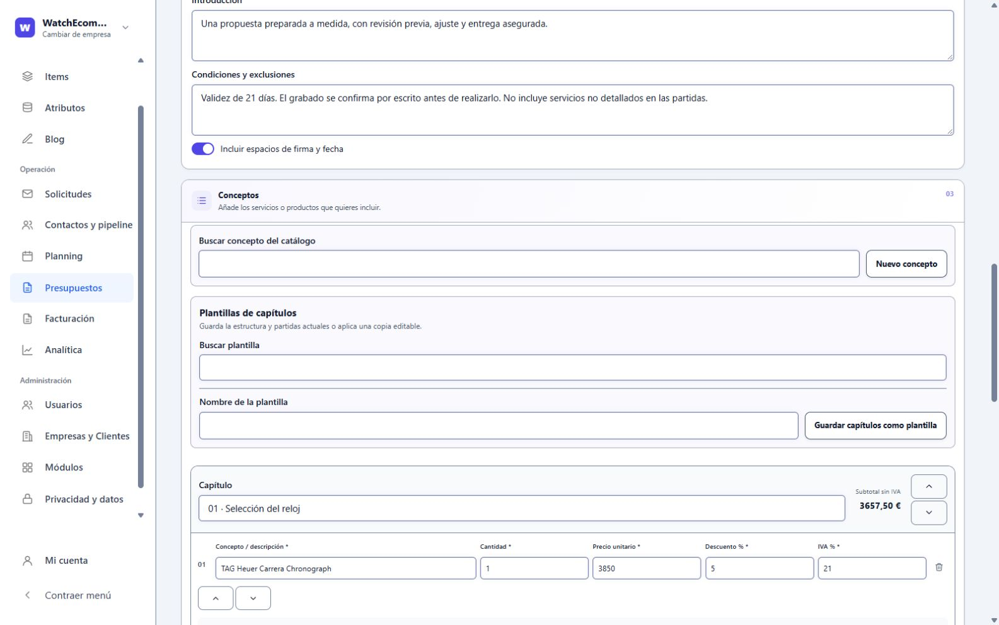

1. **Buscar plantilla.** Localiza una estructura guardada para esta empresa.
2. **Nombre de la plantilla.** Identifica la estructura que vas a guardar.
3. **Guardar capítulos.** Conserva los capítulos y partidas actuales como plantilla.

- Aplicar una plantilla incorpora una copia editable. Comprueba las líneas resultantes, el orden y los importes antes de guardar el presupuesto.
- El buscador de conceptos recupera servicios del catálogo. Nuevo concepto guarda una ficha reutilizable; una línea escrita manualmente no equivale a dar de alta catálogo.

### Pago, retención y notas

08 / 6 · Completar las condiciones económicas.

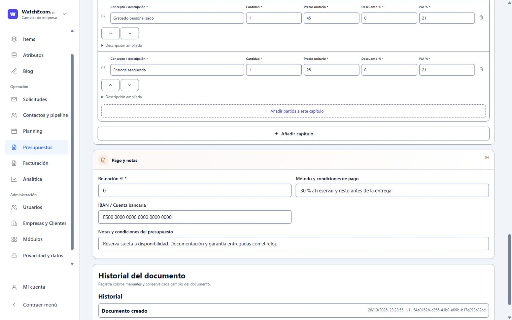

1. **Retención.** Revisa el porcentaje aplicable y su efecto en el total.
2. **Método de pago.** Explica plazos y forma de pago; completa el IBAN si procede.
3. **Notas.** Añade las condiciones finales que deban acompañar al documento.

- Contrasta el contenido con la vista previa, incluidas todas las páginas y los saltos de capítulo.
- Guarda en Borrador si aún falta revisar algo. Cuando esté preparado, cambia a Enviado y guarda antes de generar el enlace de respuesta.

## 09 · Enviar y recibir la respuesta

### Enviar el enlace de respuesta

09 / 1 · Copia privada o envío por email.

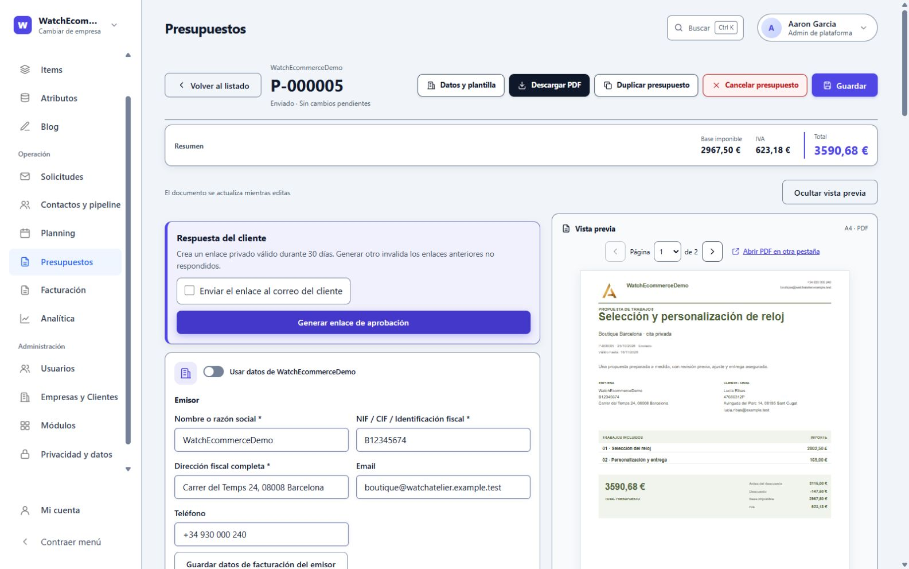

1. **Enviar por correo.** Márcalo si quieres que el panel envíe el enlace al email del cliente.
2. **Generar enlace.** Requiere presupuesto guardado como Enviado y sin cambios pendientes.
3. **Documento enviado.** La cabecera identifica el presupuesto y su estado antes de generar el enlace.

- Sin marcar el envío por correo, genera y copia el enlace para compartirlo por tu canal habitual. El enlace es privado y muestra su vencimiento.
- Un enlace nuevo invalida los anteriores aún no respondidos. Revisa el mensaje final: crear un enlace no demuestra que el correo se haya entregado.

**Caducidad y versiones**

El enlace se genera con validez de 30 días. La respuesta queda asociada a una versión del presupuesto; revisa el historial si corriges una oferta ya respondida.

### Respuesta, copia y conversión

09 / 2 · Qué hacer cuando el cliente decide.

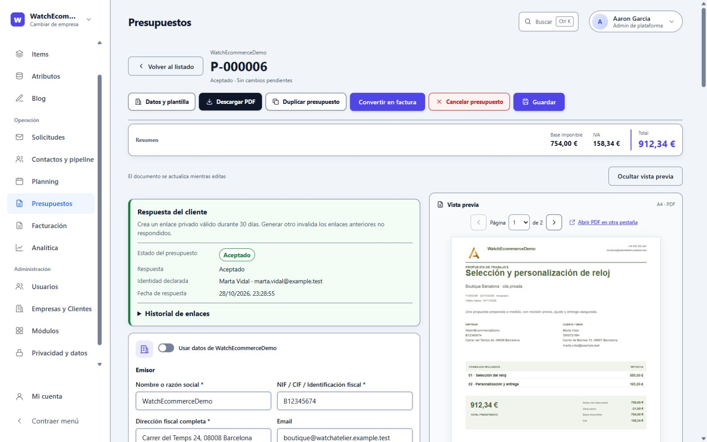

1. **Convertir en factura.** Disponible cuando el presupuesto está Aceptado y guardado.
2. **Duplicar.** Abre una copia nueva para preparar otra propuesta.
3. **Descargar PDF.** Obtén la versión que quieras entregar y revisa su estado.

- El bloque de respuesta muestra decisión, identidad declarada y fecha. El historial distingue respuestas anteriores de la versión actual.
- Para convertir, guarda los cambios y confirma el diálogo. Después localiza la factura resultante en Facturación y revisa su contenido antes de emitir.

**No sobrescribas una respuesta**

Si corriges una oferta respondida, conserva su trazabilidad y comparte un enlace de la versión revisada cuando el estado lo permita. Duplicar no modifica el original.

## 10 · Crear y emitir una factura

### Facturación: listado y saldos

10 / 1 · Localizar documentos y separar emisión de cobro.

1. **Nueva factura.** Abre el editor completo.
2. **Estado de cobro.** Filtra vencidas, pendientes, parciales, cobradas o a favor.
3. **Datos y plantilla.** Configura emisor, series y apariencia de nuevos documentos.

- El buscador admite número, cliente, identificación fiscal o concepto. El filtro Estado distingue Borrador, Emitida, Pagada y Cancelada.
- Total es el importe del documento; Saldo, lo que queda tras sus movimientos. Una factura emitida puede seguir pendiente o estar parcialmente cobrada.

### Cliente nuevo y ficha fiscal

10 / 2 · Alta reutilizable desde factura o presupuesto.

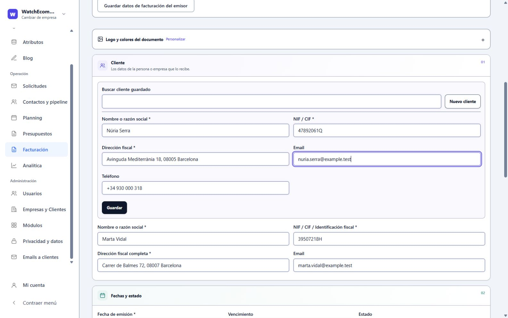

1. **NIF / CIF.** Completa la identificación del destinatario.
2. **Dirección fiscal.** Introduce la dirección completa y revisa contacto/email.
3. **Guardar cliente.** Guarda la ficha y selecciónala en el documento.

- Primero busca un cliente existente para evitar duplicados. Si falta, pulsa Nuevo cliente y completa razón social y los campos obligatorios.
- La información seleccionada se copia en el documento. Una corrección en esa copia no actualiza automáticamente todo el directorio ni los documentos anteriores.

### Fechas, vencimiento y emisión

10 / 3 · Elige el momento de convertir el borrador en factura emitida.

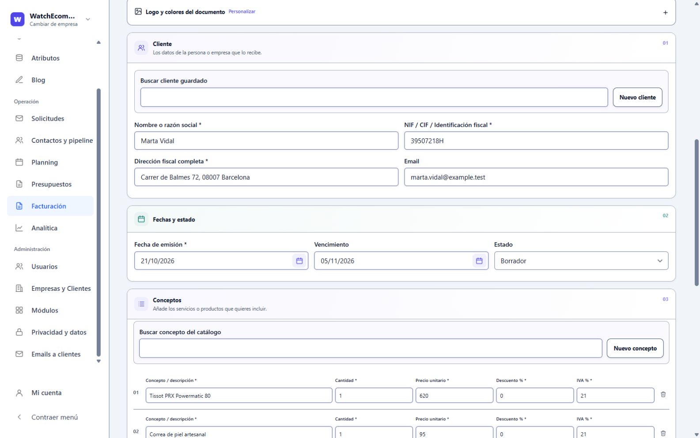

1. **Fecha de emisión.** Revisa el día que llevará el documento.
2. **Vencimiento.** Define cuándo debe pagarse; se usa para saldos vencidos y avisos.
3. **Estado.** Mantén Borrador mientras preparas; elige Emitida cuando esté revisada.

- Cambiar el selector no sustituye Guardar. Antes de guardar como Emitida, revisa destinatario, emisor, líneas, impuestos, fechas y total.
- Después de emitida, el contenido queda bloqueado para edición y cancelación ordinarias. Los cobros y la rectificación se gestionan con sus acciones propias.

**Emisión deliberada**

Guardar una rectificativa también emite un documento nuevo. No uses el cambio de estado como prueba sin revisar el resultado que estás confirmando.

### Líneas, descuentos e impuestos

10 / 4 · Construir el detalle de la factura.

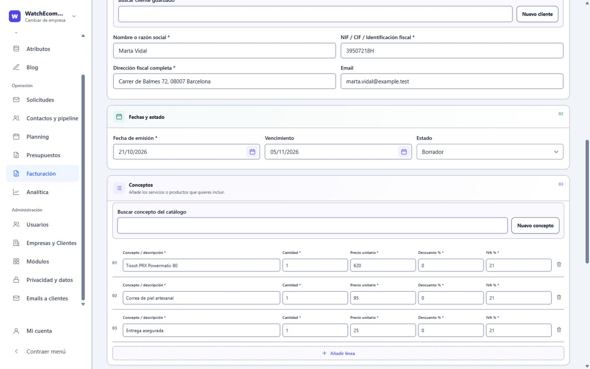

1. **Catálogo.** Selecciona un servicio o producto guardado.
2. **Nuevo concepto.** Abre el alta de una ficha reutilizable.
3. **Cantidad y precio.** Comprueba también descuento e IVA de cada línea.
4. **Añadir línea.** Incluye más partidas; usa la papelera de su fila para eliminar.

- El descuento se aplica a la línea. En Pago y notas revisa la retención general, las condiciones, el IBAN y las notas del documento.
- El resumen distingue base, IVA y total. Comprueba los porcentajes adecuados antes de emitir; la vista previa permite revisar cómo se presentan.

### Guardar conceptos reutilizables

10 / 5 · Mantener un catálogo útil para ambos tipos de documento.

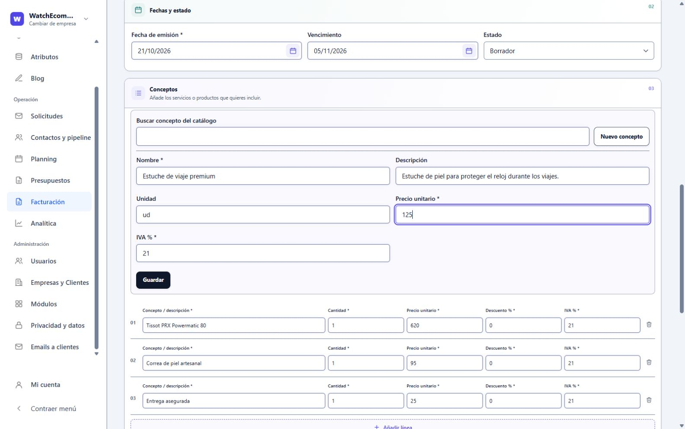

1. **Nombre.** Identifica el servicio o producto del catálogo.
2. **Unidad.** Define la referencia usada para la cantidad, cuando corresponda.
3. **Guardar concepto.** Revisa descripción, precio e IVA antes de confirmar.

- Tras el alta, selecciona el concepto en la factura o presupuesto. Comprueba los valores copiados y ajusta la partida si ese trabajo lo necesita.
- El catálogo acelera la preparación, pero no sustituye la revisión de los importes particulares de cada documento.

### Vista previa y PDF final

10 / 6 · Revisar el documento antes de compartirlo.

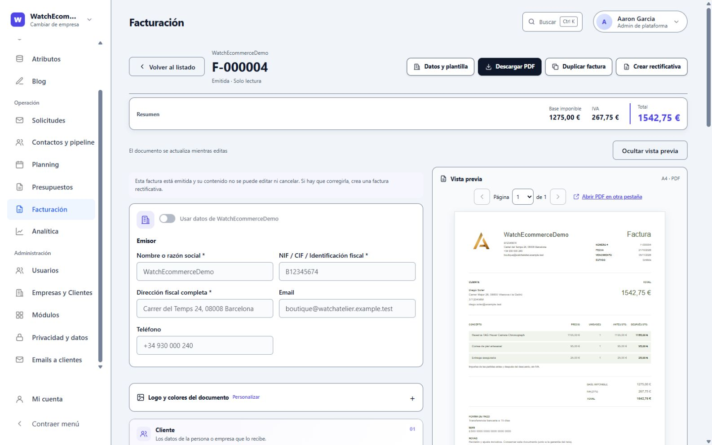

1. **Crear rectificativa.** Corrige una emitida mediante un documento nuevo.
2. **Duplicar factura.** Prepara otra a partir del contenido existente.
3. **Descargar PDF.** Descarga el documento desde la cabecera.

- La vista previa se muestra al lado cuando hay espacio; Mostrar/Ocultar vista previa controla el panel. Usa el selector de página y las flechas para revisar todas sus páginas.
- Descargar con cambios pendientes puede mostrar un borrador. Guarda primero la versión que quieras entregar y revisa número, estado, logo, datos y totales.

**El PDF no registra pagos**

Descargar o compartir el archivo no actualiza el saldo. Registra solo cobros efectivamente recibidos desde Cobros e historial.

## 11 · Cobros y rectificativas

### Registrar un cobro recibido

11 / 1 · Importe, fecha y referencia del movimiento.

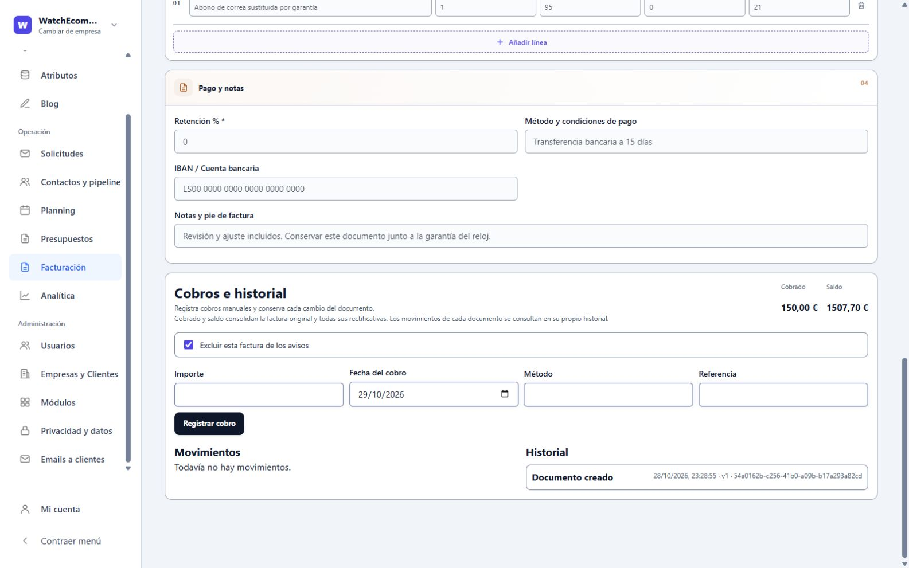

1. **Importe.** Indica la cantidad recibida y revisa el saldo pendiente.
2. **Método.** Describe cómo se recibió; completa fecha y referencia para localizarlo.
3. **Registrar cobro.** Confirma únicamente un pago que realmente has recibido.
4. **Historial.** Consulta los cambios del documento y su versión.

- La cabecera del bloque separa Cobrado y Saldo. Un cobro parcial deja importe pendiente; revisa el resultado tras registrar cada movimiento.
- Si un movimiento es incorrecto, usa Revertir junto a él y explica la causa. La reversión se añade al historial; no borra el movimiento original.

**Saldo de la factura y sus rectificativas**

La captura muestra una rectificativa con el saldo consolidado de su factura original. Cada documento conserva sus propios movimientos; abre la original para consultar el cobro ficticio de 150 €.

### Historial y recuperación

11 / 2 · Leer versiones y recuperar borradores.

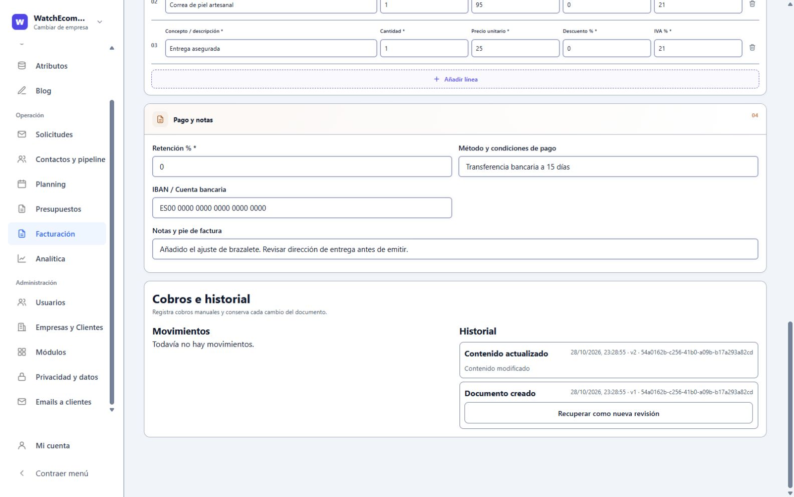

1. **Historial.** Cada entrada identifica acción, fecha, versión y autor disponible.

- Cargar más muestra entradas anteriores cuando existen. Si el documento sigue en Borrador, una versión anterior compatible puede ofrecer Recuperar/Restaurar.
- La recuperación crea una revisión nueva: comprueba el contenido resultante y guarda. Una factura emitida se corrige con rectificativa, no restaurando un borrador.

**Autoguardado y conflictos**

La copia de recuperación está aislada por usuario, empresa y tipo. Compara fecha y versión antes de recuperarla; no sobrescribas otra pestaña sin revisar. No sustituye un respaldo.

### Preparar una rectificativa

11 / 3 · Identificar original, método y causa.

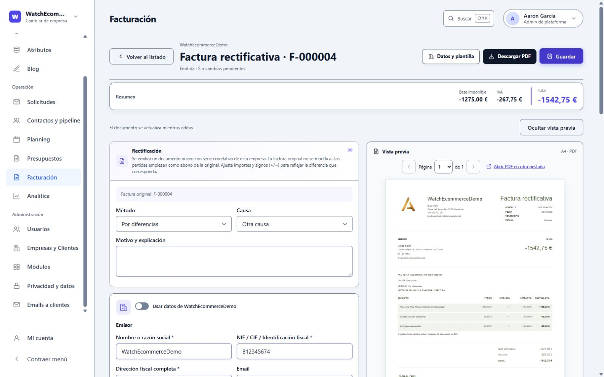

1. **Método.** Elige Por diferencias o Por sustitución.
2. **Causa.** Selecciona el motivo tipificado que corresponda.
3. **Motivo y explicación.** Describe qué se corrige y por qué.
4. **Guardar.** Emite un documento nuevo; revisa todo antes de pulsarlo.

- Desde una factura emitida o pagada, pulsa Crear rectificativa. Comprueba la factura original indicada en el bloque Rectificación.
- La serie es independiente y correlativa por empresa (FR por defecto). La original permanece intacta; método y causa son decisiones distintas.

**Antes de emitir**

Revisa causa, cifras, signos y datos con la persona responsable de facturación. Esta pantalla es una preparación: abrirla no emite la rectificativa.

### Ajustar diferencias y sustituciones

11 / 4 · Revisar el signo de cada partida.

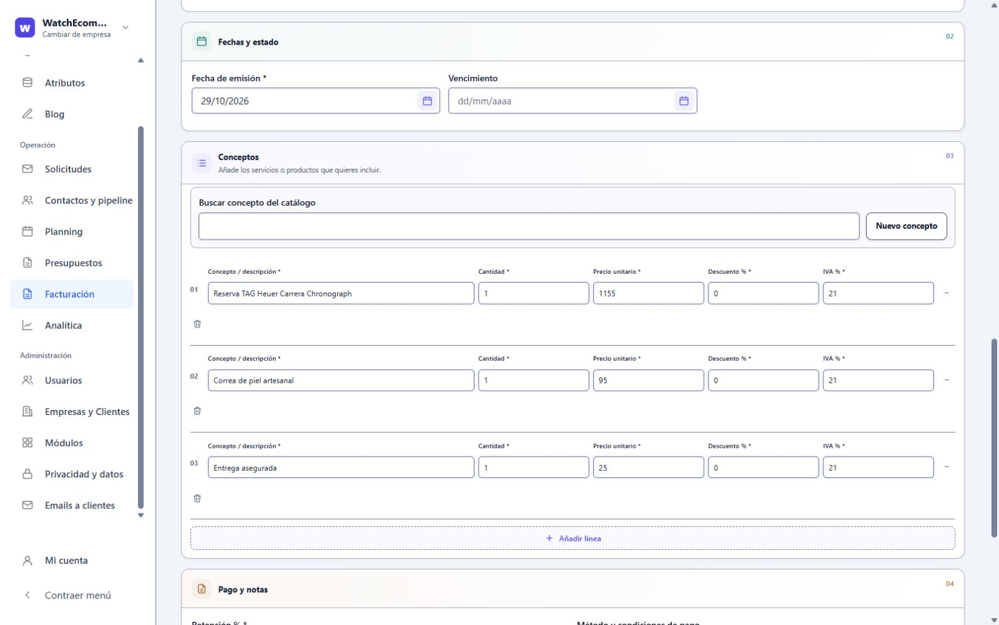

1. **Signo.** Alterna si una partida resta o suma al importe de la corrección.
2. **Precio y cantidad.** Ajusta los valores para representar la corrección real.
3. **Añadir línea.** Incorpora conceptos nuevos si la corrección los requiere.

- Por diferencias, las partidas empiezan como abono de la original. Modifica cantidades/importes y signos para reflejar la diferencia necesaria.
- Por sustitución, expresa el contenido correcto; el PDF refleja también la diferencia respecto al original. Revisa el método seleccionado antes de guardar.

**Saldo a favor**

Una rectificativa negativa puede dejar importe a favor del cliente. El panel no ejecuta transferencias ni registra una devolución bancaria automática.

## 12 · Marca y avisos de vencimiento

### Emisor, series y valores por defecto

12 / 1 · Datos y plantilla de esta empresa.

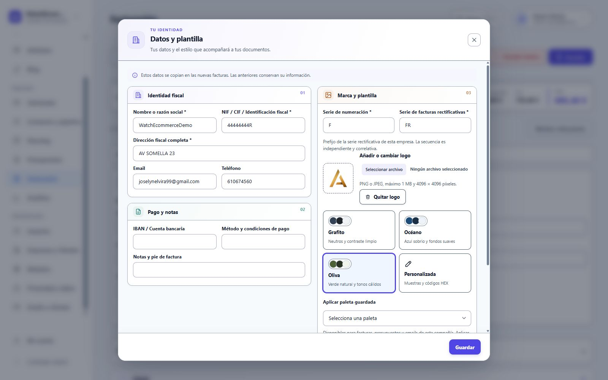

1. **Identidad fiscal.** Revisa razón social, identificación, dirección y contacto.
2. **Marca y plantilla.** Configura la presentación y numeración de nuevos documentos.
3. **Serie.** Revisa el prefijo de facturas y la serie independiente de rectificativas.

- En Presupuestos, Datos y plantilla permite configurar su prefijo específico. Verifica siempre la empresa activa antes de cambiar series o datos.
- Pago y notas guarda condiciones, IBAN y notas habituales. Estos valores se copian al preparar nuevos documentos; los anteriores conservan su información.

### Logo, paletas y HEX

12 / 2 · Personalizar manteniendo la legibilidad.

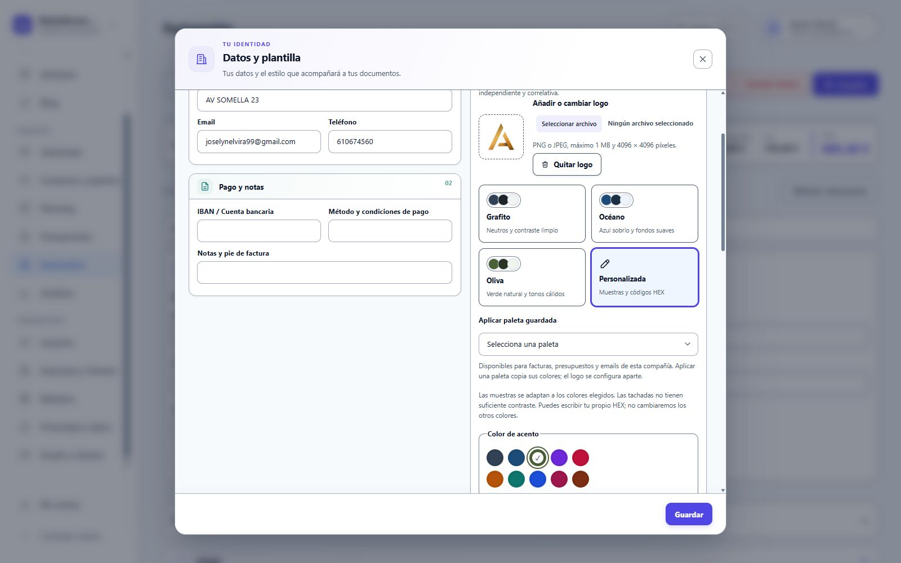

1. **Logo.** Usa PNG o JPEG dentro de los límites indicados en pantalla.
2. **Paletas.** Elige Grafito, Océano u Oliva como punto de partida.
3. **Personalizada.** Ajusta muestras y códigos HEX para cada función del color.
4. **Paleta guardada.** Copia una combinación de esta compañía; el logo va aparte.

- Personalizada separa acento, texto principal/secundario, papel y tablas. Las muestras tachadas avisan de contraste insuficiente; revisa el conjunto en la vista previa.
- Puedes dar nombre a una combinación para reutilizarla. Guardar una paleta no sustituye guardar la plantilla o el documento que estás preparando.

**Identidad del documento**

Cada factura o presupuesto conserva una copia de la apariencia utilizada. Cambiar la plantilla no rediseña los documentos ya guardados.

### Avisos de vencimiento

12 / 3 · Calendario de envíos y exclusiones.

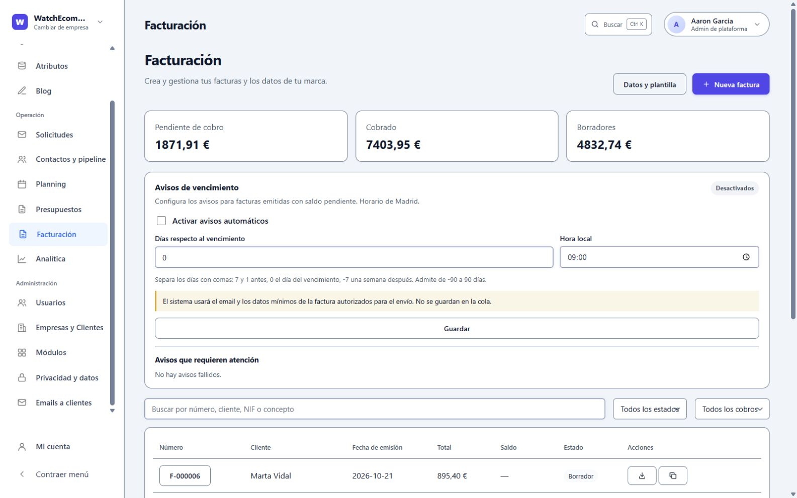

1. **Activar avisos.** Un administrador decide si se envían automáticamente.
2. **Días.** Separa los desplazamientos con comas; revisa también la hora de Madrid.
3. **Guardar.** Confirma la programación para esta empresa.

- 7 y 1 son días antes; 0, el día del vencimiento; -7, una semana después. Se admiten de -90 a 90 días y hasta ocho desplazamientos.
- Una factura emitida puede excluirse desde su bloque de cobros. Revisa fallos recientes antes de reintentar. Una pagada o excluida no debe recibir el aviso.

**Qué recibe el cliente**

Número, vencimiento y saldo pendiente, sin conceptos ni PDF adjunto. Revisa email y configuración del entorno antes de activar el envío.

## 13 · Emails y resumen semanal

Dos herramientas distintas para comunicar y revisar.

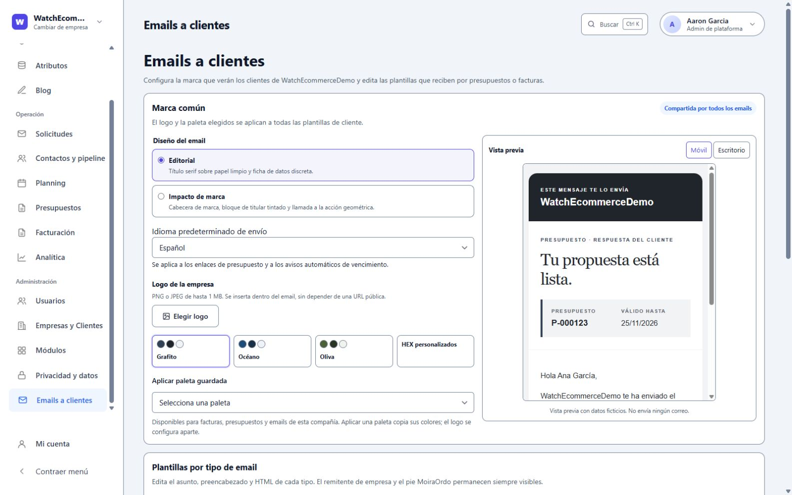

1. **Elegir logo.** Configura la marca común para las plantillas.

- Elige diseño e idioma, revisa la vista previa y edita asunto, preencabezado y HTML conservando los nombres entre llaves. Guarda.
- El historial conserva diez versiones anteriores por empresa. Restaurar crea una entrada nueva. El resumen semanal llega a administradores los lunes a las 09:00 de Madrid.

**Vista previa sin envío**

La vista previa no envía correos. Las plantillas son para aprobación y vencimiento; el resumen semanal no tiene pestaña propia y contiene solo cifras agregadas.

## 14 · Leer la analítica

Consulta el periodo adecuado y convierte cifras en acciones.

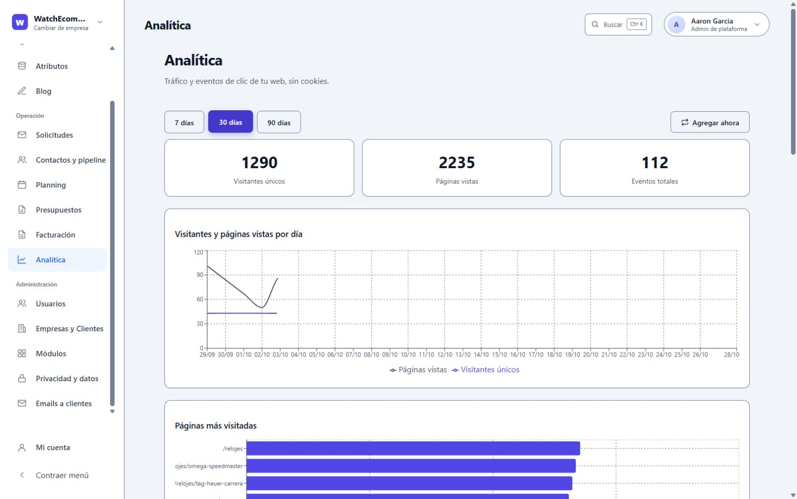

1. **Periodo.** Alterna 7, 30 o 90 días antes de interpretar cifras.
2. **Agregar ahora.** Actualiza resúmenes cuando esté habilitado.

- Revisa visitantes, vistas, eventos, páginas, orígenes, idiomas y conversiones. Los ceros pueden significar que no hay tráfico en ese intervalo.
- La gestión de eventos requiere que la web emita los eventos correspondientes. Definirlos en el panel no conecta una web externa.

**Eventos de la web**

Crear una definición no conecta por sí solo una web externa. La integración debe emitir el evento correspondiente para que aparezca actividad.

## 15 · Equipo, cuenta y módulos

Cada persona trabaja con el acceso que necesita.

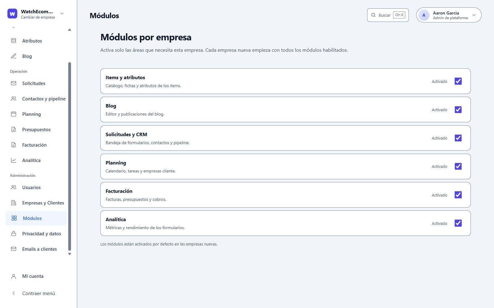

1. **Empresa y módulos.** Comprueba el ámbito antes de cambiar un área.
2. **Interruptor.** Solo plataforma activa o desactiva módulos; no borra su contenido.

- En Usuarios revisa miembro y rol: Admin, Editor o Visualizador. Algunas acciones son exclusivas de plataforma.
- Mi cuenta reúne perfil, Seguridad y organización. El menú de usuario permite idioma, tema y cerrar sesión. No compartas credenciales.

**Tema del panel y diseño del documento**

Elegir claro u oscuro cambia tu interfaz. El logo, la paleta y la apariencia de los documentos se configuran por separado en Datos y plantilla.

## 16 · Privacidad de contactos

Revisión manual, exportación y anonimización con alcance explícito.

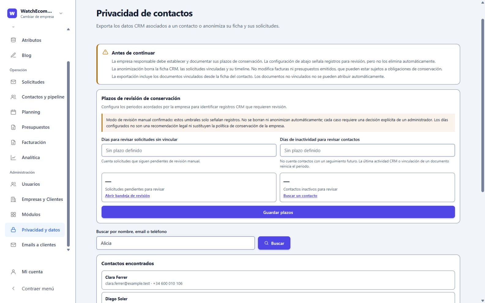

1. **Guardar plazos.** Configura umbrales de revisión; no ejecuta borrados.
2. **Buscar.** Localiza una ficha por nombre, email o teléfono.

- Selecciona el contacto y revisa el alcance de exportación o anonimización. Los documentos fiscales se conservan según el alcance de la operación.
- Exportar descarga un JSON: guárdalo con acceso restringido. Anonimizar requiere las confirmaciones del panel y una decisión individual.

**Revisión manual**

Los umbrales no son plazos legales ni activan purgas. Consulta la política de la empresa y al responsable de privacidad antes de anonimizar.

## 17 · Chuleta para el día a día

Qué revisar cuando algo no sale como esperabas.

- **Una lista está vacía.** Comprueba empresa, filtros, estado y periodo. Usa Reintentar si aparece.
- **No puedes guardar.** Mantén abierto el formulario, revisa los campos y la conexión, y conserva el mensaje de error.
- **Falta un botón.** Revisa rol y módulos con la persona administradora.
- **Un presupuesto no se envía.** Confirma estado Enviado, cambios guardados y email del cliente. Lee el resultado del envío.
- **Necesitas recuperar un borrador.** Compara fecha y versión de la copia ofrecida. Guardar confirma; el autoguardado no emite ni garantiza una copia remota.
- **Aparece una función o tabla no disponible.** Comunica sección y mensaje al soporte técnico; repetir la operación no instala la función.

**Pequeño glosario**

**Empresa activa:** ámbito actual de trabajo.

**Pipeline:** etapas del seguimiento comercial.

**Borrador:** documento aún en preparación.

**Emitida:** factura bloqueada para edición ordinaria.

**Saldo:** importe pendiente tras los movimientos registrados.

**Rectificativa:** documento nuevo que corrige una factura anterior.

**Al terminar**

Comprueba las confirmaciones de guardado, deja los seguimientos con fecha y cierra sesión si compartes equipo. Este manual describe el uso del panel; la aplicación no integra actualmente remisión VERI*FACTU ni QR SIF. Consulta su adecuación con tu asesoría antes de usarla para facturación sujeta a requisitos específicos.
