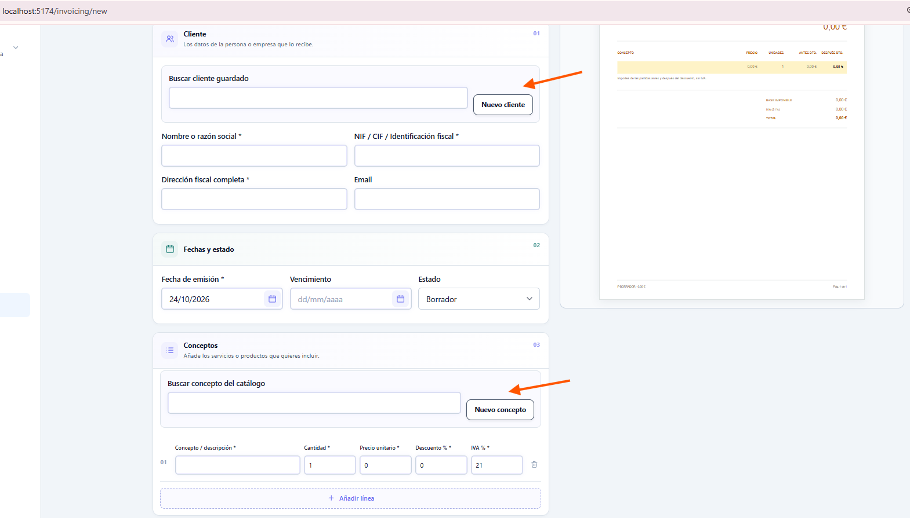
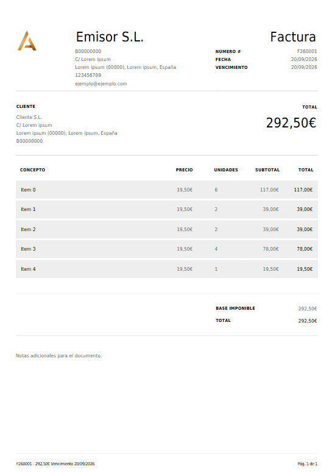

# Manual de uso del panel de administración

Guía para usuarios de **toda la web privada de administración**, versión local del 26/10/2026. Los nombres descritos corresponden al menú español. La organización del panel puede ocultar apartados según el rol y los módulos activos de la empresa. El código local y el panel desplegado pueden diferir mientras se aplican migraciones y funciones Edge.

## Mapa del panel

Captura del editor real de facturas. Las flechas naranjas son anotaciones de una revisión anterior, no elementos de la aplicación; señalaron dos buscadores cuya alineación se corrigió después. Se conserva como referencia del recorrido, no como prueba del aspecto actual. El PDF de ejemplo también procede del panel. No se han podido obtener capturas autenticadas recientes de las demás áreas; esas secciones se explican según las pantallas del código local.

| Apartado | Para qué sirve | Ruta |
| --- | --- | --- |
| Dashboard | Resumen de actividad y accesos rápidos | `/` |
| Items | Buscar y gestionar los productos/contenidos | `/items` |
| Mi información | Definir tipos de item, atributos y formularios | `/my-data` |
| Blog | Gestionar artículos del sitio | `/blog` |
| Leads | Consultar y actualizar solicitudes recibidas | `/leads` |
| Contactos y pipeline | Ficha unificada, seguimiento y etapas comerciales | `/contacts` |
| Planning | Planificar tareas y vencimientos | `/planning` |
| Presupuestos | Crear, enviar, aceptar y convertir presupuestos | `/quotes` |
| Facturación | Emitir facturas, registrar cobros y revisar historial | `/invoicing` |
| Analítica | Consultar visitas, eventos y tendencias | `/analytics` |
| Usuarios | Gestionar miembros según permisos | `/users` |
| Empresas | Directorio de clientes de Planning | `/companies` |
| Módulos | Configurar módulos para una empresa (solo administrador del sistema) | `/settings/modules` |
| Privacidad y datos | Exportar o anonimizar una ficha CRM | `/settings/privacy` |
| Mi cuenta | Datos personales, seguridad y preferencias de empresa | `/profile` |

Las páginas legales están enlazadas por el panel en `/privacy-policy`, `/legal-notice` y `/cookies-policy`.

## Antes de realizar trámites

1. Inicia sesión. Si no recuerdas la contraseña, usa la recuperación de acceso; el enlace recibido permite crear una nueva.
2. En el selector de empresa de la barra lateral, elige la compañía con la que trabajarás. Planning, clientes, facturas, presupuestos y permisos están aislados por empresa.
3. Revisa el rol. **Admin** puede administrar miembros; **Editor** crea y modifica contenido; **Lector** consulta. Solo el administrador del sistema puede cambiar los módulos de las empresas. Si falta un botón, pide a la persona administradora adecuada que revise tu acceso.
4. En móvil, abre el menú lateral desde la barra superior y ciérralo después de elegir el apartado. En tablet se puede contraer el menú lateral.
5. El menú de usuario permite cambiar idioma/tema y acceder a Mi cuenta o cerrar sesión. Preferencias concretas dependen del perfil habilitado.
6. Pulsa **Buscar** en la barra superior o usa `Ctrl+K` (Command+K en Mac) para buscar items, contactos, facturas y presupuestos de la empresa activa. Usa flechas y Enter para abrir un resultado; Esc cierra el buscador.

Al cambiar de compañía, los formularios y listados se vuelven a cargar para el nuevo ámbito. No uses el selector para intentar acceder a recursos de otra compañía.

## Dashboard

El inicio muestra el resumen disponible para la empresa y el usuario: actividad, indicadores y accesos a secciones. Las tarjetas que no tienen datos pueden aparecer como vacías o sin valor; eso no necesariamente indica un fallo. Selecciona otra tarjeta o el menú lateral para abrir el trámite relacionado. Para revisar métricas con intervalos y desgloses, ve a **Analítica**.

## Items: productos y contenidos

1. Abre **Items** y busca por nombre. Usa los filtros de estado, tipo, ordenación y atributos disponibles.
2. Selecciona una tarjeta o fila para abrir el detalle del item. La URL conserva filtros y página, de modo que Volver devuelve al mismo contexto.
3. Desde el detalle, consulta o edita los campos permitidos, atributos, imágenes y archivos. Añade o reemplaza medios siguiendo los límites que muestra el formulario.
4. Guarda los cambios y espera la confirmación. Si aparece un error, conserva la pantalla y vuelve a intentar; no cierres el detalle hasta resolverlo.

Los tipos y atributos que aparecen en Items se configuran en **Mi información**. Si un campo no existe, primero revisa esa sección. Al editar un item también puedes completar slug y metadatos SEO (título, descripción e imagen Open Graph) si aparecen en el formulario. Revisa la vista previa antes de guardar; el panel no sustituye la generación de metadatos públicos en la web cliente.

## Mi información: tipos y atributos

Esta sección define cómo se rellenan y presentan los items.

1. Elige un tipo de item de la lista. Crea uno si el contenido requiere una estructura distinta.
2. Añade atributos con etiqueta, tipo de dato, opciones y reglas de validación disponibles. Reordénalos con los controles de movimiento.
3. Revisa la vista previa del formulario antes de guardar para confirmar el orden y los campos.
4. Importa o exporta la plantilla de atributos mediante las acciones de Excel/CSV que ofrece la pantalla. Revisa el archivo descargado antes de volver a importarlo.
5. Guarda explícitamente. Si la pantalla informa de que faltan columnas o una migración, no repitas la importación: pide que se habilite el esquema de atributos en el entorno.

Un cambio de atributos afecta la captura futura; revisa un item existente antes de borrar un atributo que pueda contener datos.

## Blog

Abre **Blog** para localizar entradas y crear o editar publicaciones. Usa el buscador/listado para abrir el artículo correcto, modifica título, contenido y estado editorial, revisa el resultado y guarda. Puedes dejarlo en borrador, publicar o archivar. Completa slug y metadatos SEO (título, descripción e imagen Open Graph) cuando corresponda. Confirma el estado de publicación antes de salir. El HTML no se ejecuta desde el contenido Markdown. La web pública cliente debe implementar sus propias rutas y metadatos con el contrato `company-site-snippet/BLOG_INTEGRATION.md`.

## Leads

1. Abre **Leads** y filtra/busca la solicitud por persona, email o estado.
2. Abre el detalle para leer los datos y el mensaje recibidos.
3. Actualiza el estado o la información de seguimiento según las opciones visibles y guarda.
4. Para borrar un registro, confirma en el cuadro de diálogo. La eliminación no se puede recuperar desde el panel.

No copies datos personales del lead a notas públicas ni a capturas compartidas.

## Contactos y pipeline

Abre **Contactos y pipeline** para trabajar con las fichas creadas desde solicitudes o añadidas al CRM. Cada columna del kanban corresponde a una etapa comercial; cambia una ficha de etapa con el selector de su tarjeta. Usa la búsqueda, el filtro de seguimientos y la fecha de próximo contacto para localizar lo pendiente.

Al abrir una ficha puedes editar nombre, email, teléfono, etapa, responsable y seguimiento. El historial permite añadir llamadas, emails, notas y visitas, y ver solicitudes relacionadas. Desde la misma ficha se pueden enlazar facturas o presupuestos disponibles de esa empresa. El origen, la ruta y la campaña se muestran si llegaron en el formulario.

Las solicitudes que coinciden con contactos por email o teléfono se vinculan automáticamente cuando la coincidencia es inequívoca. Si email y teléfono apuntan a contactos diferentes, la solicitud aparece en **Revisión manual**: elige el contacto correcto o crea uno nuevo. El sistema no fusiona fichas por su cuenta. Los administradores y editores pueden configurar etapas; archivar una etapa requiere que no tenga contactos.

## Privacidad y datos de contactos

La opción **Privacidad y datos** está limitada a administradores. Busca por nombre, email o teléfono y selecciona la ficha para consultar cuántas solicitudes, actividades y documentos vinculados se verán afectados.

- **Exportar datos** descarga un JSON con los datos CRM asociados y los documentos enlazados desde la ficha. Los documentos sin vínculo no se pueden atribuir automáticamente. Guarda el archivo con acceso restringido y entrégalo solo a personas autorizadas.
- **Anonimizar contacto** requiere revisar el alcance, marcar la confirmación y confirmar la acción. La ficha y sus actividades se eliminan; las solicitudes vinculadas conservan su estado operativo, pero sustituyen los datos personales por un marcador genérico y eliminan contenido, origen y consentimiento. Las facturas y presupuestos se conservan y se quitan sus vínculos con el contacto. Si hay dudas sobre obligaciones de conservación, consulta al responsable de privacidad antes de continuar.

La pantalla no ejecuta purgas automáticas por antigüedad. Anonimizar es una acción distinta de borrar todos los documentos de la empresa.

## Planning: clientes, calendario y vencimientos

### Directorio de empresas cliente

En **Empresas** busca por nombre y usa **Añadir empresa** para crear una ficha de cliente de Planning. Completa razón social, identificación fiscal, dirección, teléfono, email, persona responsable y color si están disponibles. Abre una ficha para editarla o archivarla/eliminarla según la acción que muestre el panel. Este directorio de planificación es independiente del buscador fiscal de clientes del editor de facturas.

### Crear una tarea

1. Abre **Planning**, selecciona las empresas cliente que quieres ver y elige Día, Semana o Mes. Usa Anterior, Siguiente y Hoy para cambiar de tramo.
2. Pulsa una franja del calendario para crear una tarea. Escribe título, descripción, empresa cliente y tipo.
3. Marca **Todo el día** o completa inicio y final. La duración final debe ser posterior al inicio.
4. Configura recurrencia y recordatorios. Añade adjuntos si hacen falta y comprueba la fecha, zona horaria y hora antes de guardar.
5. Pulsa Guardar. Para cambiar una tarea, ábrela y selecciona Editar; para eliminarla confirma la acción.

En calendario de Día/Semana se puede arrastrar una tarea para cambiar la fecha/hora o usar el tirador inferior para ajustar duración. El cambio pide confirmación y ofrece **Deshacer** durante unos segundos si nadie modifica la tarea después. Si la tarea es recurrente, el arrastre aplica a toda la serie; el diálogo lo indica antes de guardar. Teclado y pantalla táctil pueden usar **Editar** para introducir fecha y hora directamente. Escape durante un arrastre descarta el movimiento sin guardar.

### Vencimientos de Planning

Activa la vista de facturación del Planning para listar los vencimientos asociados. Crea o edita un registro con título, fecha, importe, dirección (cobrar/pagar), empresa y recurrencia. Los vencimientos de Planning son previsiones de trabajo, no cobros reales de facturas. Para un cobro real usa **Facturación → Cobros e historial**.

## Presupuestos

1. En **Presupuestos**, pulsa **Nuevo presupuesto**. Completa cliente, emisor, fechas y los datos de presentación (título, lugar, introducción, condiciones y firmas).
2. Añade líneas desde el catálogo o manualmente. Agrupa las partidas por capítulos y arrastra con los controles de orden accesibles.
3. En Plantillas de capítulos busca y aplica una copia editable. Para guardarla, nómbrala y guarda; archivar solo la quita de futuras búsquedas.
4. Comprueba IVA, descuentos, cantidades, total, diseño y PDF. Guarda como Borrador y cambia a Enviado, Aceptado o Rechazado cuando corresponda.
5. Para convertir, abre un presupuesto **Aceptado**, pulsa **Convertir en factura** y confirma. Se crea una factura borrador; revisa fechas, emisor, cliente y partidas antes de emitir.
6. Para pedir la respuesta del cliente, guarda el presupuesto como **Enviado** y vuelve a abrirlo. En el bloque de respuesta del cliente, genera un enlace y cópialo para enviarlo por el canal habitual. El panel no manda ese correo por ti. El enlace tiene vencimiento; si generas otro, el anterior deja de servir. La persona que lo recibe podrá aceptar o rechazar y declarar su nombre/email; el motivo de rechazo es opcional.
7. Consulta en el mismo bloque la decisión, fecha, identidad declarada y el historial de enlaces. La respuesta queda registrada y no se cambia desde el panel; para corregir el contenido de una oferta respondida, prepara un presupuesto nuevo.

Duplicar crea una copia nueva sin número y vacía las fechas. El original permanece intacto.

## Facturación: crear, emitir y descargar

1. Abre **Facturación → Nueva factura**. En **Datos y plantilla** se gestionan datos fiscales, serie, logo y diseño de la compañía.
2. Busca el cliente guardado o pulsa **Nuevo cliente**. Los datos seleccionados se copian como instantánea y se pueden corregir en el documento sin cambiar el directorio.
3. Completa fecha y vencimiento. En Conceptos selecciona un servicio/producto o pulsa **Nuevo concepto** para guardarlo en el catálogo. Comprueba cantidad, precio, descuento e IVA.
4. Revisa retención y datos de pago, como IBAN y condiciones. La vista previa muestra el documento final.
5. Guarda como Borrador mientras preparas. Para emitir, elige Emitida y guarda después de revisar todos los datos. Una emitida queda bloqueada: ya no se edita ni se cancela desde el estado ordinario.
6. Descarga el PDF desde la cabecera. Si hay cambios sin guardar se marca como borrador. Los documentos conservan su propia copia de la identidad visual.

### Serie de facturas y presupuestos

En **Datos y plantilla** configura el prefijo de factura y el prefijo de presupuesto por separado. El sistema completa cada serie con una secuencia numérica. Comprueba la empresa activa antes de cambiarla.

### Crear una factura rectificativa

Abre una factura emitida o pagada y pulsa **Crear rectificativa**. Selecciona el método, el motivo y explica la causa; revisa la factura original vinculada. Ajusta partidas y guarda. La operación crea una factura nueva emitida, con número propio y correlativo `FR-…` de la empresa. La original sigue intacta.

- **Por diferencias:** las partidas empiezan como abono de la factura original. Modifica cantidades/importes; usa los controles `−` y `+` para indicar partidas que restan o suman. Añade partidas nuevas si la corrección incrementa importes.
- **Por sustitución:** edita las partidas hasta expresar el contenido y los importes correctos. El PDF refleja también la diferencia respecto al total original.

La causa (datos obligatorios, impuesto incorrecto, supuestos del artículo 80 u otra) es distinta del método. Revisa que el motivo y las cifras coincidan con la asesoría fiscal antes de emitir. El campo de serie rectificativa está en **Datos y plantilla**; el prefijo por defecto es `FR`, con secuencia separada por empresa. Un error de rectificativa no debe resolverse editando la original.

### Cobros, saldos e historial

Usa los filtros de Facturación para vencidas, pendientes, parciales, cobradas o saldos a favor. Abre la factura y baja a **Cobros e historial**:

1. Introduce importe y fecha; método y referencia son opcionales. Registra solo cobros realmente recibidos y no excedas el saldo.
2. Si un movimiento es incorrecto, usa **Revertir** y explica el motivo. El sistema añade una reversión al historial; no borra el movimiento anterior.
3. Revisa el actor, la fecha, la versión y los cambios. **Cargar más** muestra historial anterior. Solo se recuperan versiones de borrador como una revisión nueva; las emitidas se corrigen con una rectificativa.

Una factura rectificativa con saldo negativo aparece como importe a favor del cliente. Este panel no registra devoluciones de dinero.

### Avisos de vencimiento

En el listado de **Facturación**, el bloque **Avisos de vencimiento** permite a un administrador activar o desactivar avisos automáticos, indicar de 1 a 8 días respecto del vencimiento y elegir la hora local de Madrid. Por ejemplo, `7, 1, 0, -7` significa una semana antes, un día antes, el mismo día y una semana después. Guarda los cambios para aplicarlos.

En cada factura emitida puedes excluirla de los avisos. El bloque inferior muestra los fallos recientes y permite reintentar cuando tu rol lo permite. Una factura pagada, dada de baja o cuyo módulo esté desactivado no recibe el recordatorio. Los envíos solo se producen cuando base de datos, función Edge, remitente y cron están configurados; si la pantalla informa de que la función o la tabla no existe, contacta con el administrador técnico.

Los recordatorios envían al correo del cliente el número de factura, vencimiento y saldo pendiente. No incluyen conceptos ni adjuntan el PDF. Este trámite no registra pagos: para actualizar el saldo, usa **Cobros e historial**.

## Analítica

Selecciona el periodo o intervalo y revisa visitantes únicos, vistas, tendencias, rutas, orígenes, idiomas y eventos disponibles. Si hay pocos datos, comprueba el rango y vuelve a cargar. La agregación manual actualiza los resúmenes cuando el usuario tiene permiso. En Administrar eventos se pueden crear definiciones, activar/desactivar o archivar según los controles de la pantalla. Los números son analítica agregada; no contienen el contenido fiscal de facturas.

## Usuarios y acceso

En **Usuarios**, los administradores o editores autorizados consultan miembros de la empresa activa. Busca el usuario, revisa su rol y edita las asignaciones permitidas. Los roles son Admin, Editor y Lector; el Administrador de plataforma puede crear usuarios/empresas mediante acciones adicionales. Confirma antes de revocar o cambiar acceso, porque el miembro puede dejar de trabajar en esa empresa al momento.

No compartas la cuenta de otra persona para completar un trámite. Solicita al administrador que te asigne el rol adecuado.

## Módulos por empresa

En **Módulos**, solo el **administrador del sistema** puede activar o desactivar Items, Blog, CRM, Planning, Facturación y Analítica para la empresa seleccionada. Los módulos empiezan activados. Desactivar uno oculta sus opciones y bloquea el acceso a sus datos; no borra automáticamente su contenido. Comprueba la empresa activa antes de cambiar interruptores.

## Resumen semanal por email

El resumen semanal llega automáticamente por email cada lunes a las 09:00 (hora de Madrid) a las direcciones de administradores activos de la empresa. No hay una pestaña de configuración en el panel.

El resumen contiene solo conteos: solicitudes/contactos nuevos, seguimientos vencidos, facturas emitidas/vencidas, presupuestos pendientes, tareas de la semana próxima y páginas vistas. No muestra nombres, emails de clientes, números/importes de facturas ni títulos o contenido de tareas. Si se apaga un módulo, ese módulo no aporta estadísticas.

## Mi cuenta y preferencias

- **Datos personales:** revisa los datos de perfil disponibles para tu usuario.
- **Seguridad:** cambia contraseña o revisa las opciones de autenticación disponibles. El restablecimiento se inicia desde la pantalla de acceso.
- **Empresa:** los datos y opciones que aparecen aquí dependen del rol. La ficha fiscal y la apariencia de facturación se editan desde Datos y plantilla en Facturación/Presupuestos.
- **Idioma y tema:** usa el menú superior para elegir ES/EN y claro/oscuro. El tema del panel no cambia el fondo blanco del PDF.
- **Cerrar sesión:** utiliza el menú de usuario; las copias de borrador locales se limpian según la política de sesión.

## Borradores y recuperación

En un borrador, el indicador muestra el estado del autoguardado. La copia de recuperación no obtiene número ni emite. Si al volver o recargar se ofrece recuperar una copia, compara fecha y versión y elige conscientemente. Ante un conflicto de dos pestañas, no sobrescribas la copia remota sin revisar. **Guardar** confirma el documento. Si falla la petición, conserva el formulario abierto y reintenta.

La recuperación local depende del navegador y no sustituye un respaldo. Los datos están separados por usuario, empresa y tipo de documento.

## Qué hacer si aparece un error

- **Lista vacía:** verifica la empresa activa, los filtros y el periodo. Pulsa Reintentar si el panel ofrece esa acción.
- **Error al guardar:** no cierres la página ni vuelvas atrás; copia el mensaje si aparece, comprueba la conexión y reintenta.
- **Buscador de cliente/catálogo no disponible:** completa la factura manualmente y reintenta la carga más tarde.
- **Función o tabla no habilitada:** comunica el nombre del apartado al administrador. Una migración local del proyecto no significa que ya esté aplicada en Supabase.
- **No aparece editar/crear:** pide que revisen el rol en la empresa activa.
- **Un cambio de Planning no se puede deshacer:** otro usuario o una edición posterior puede haber avanzado la versión. Vuelve a abrir la tarea y revisa su horario actual.

## VERI*FACTU y estado del aplazamiento

El Ministerio comunicó el 5/10/2026 una previsión de aplazar obligaciones pendientes del RD 1007/2023 hasta octubre de 2028. A la fecha de esta comprobación esa comunicación aún no sustituye las fechas publicadas en el BOE: el marco vigente mantiene 1/1/2027 para contribuyentes del Impuesto sobre Sociedades incluidos y 1/7/2027 para el resto de obligados. Por petición del propietario, esta aplicación no integra ahora remisión VERI*FACTU ni QR SIF. Antes de usarla para emitir en un entorno sujeto a esas obligaciones, confirma el cambio normativo y la elegibilidad con asesoría fiscal. Las rectificativas implementadas no certifican por sí solas el cumplimiento del reglamento SIF.

### Fuentes oficiales

- [AEAT: facturas rectificativas](https://sede.agenciatributaria.gob.es/Sede/iva/facturacion-registro/facturacion-iva/facturas-rectificativas.html)
- [RD 1619/2012, artículo 15](https://www.boe.es/eli/es/rd/2012/11/30/1619)
- [Comunicación oficial del Ministerio de Hacienda, 5/10/2026](https://www.hacienda.gob.es/sgt/gabsehacienda/nota-informativa-verifactu.pdf)
- [AEAT: plazos publicados para adaptación de los SIF](https://sede.agenciatributaria.gob.es/Sede/iva/sistemas-informaticos-facturacion-verifactu/nota-informativa-ampliacion-plazo-adaptacion-facturacion.html)
